<div align="center">

# Layered Design in Code

### A graphic-design process built from code — not from image generation

**Martin Morfe** · Morfe Maison

<br>

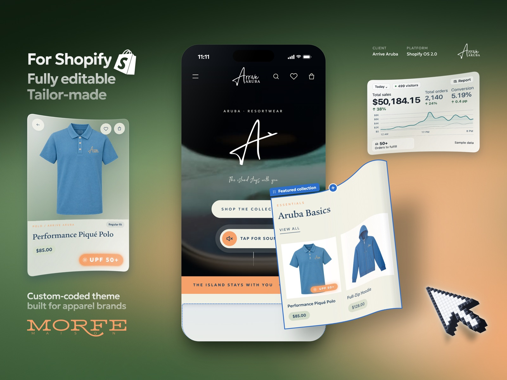

<sub>Final cover for the Upwork portfolio item <i>Arrive Aruba — custom Shopify theme</i>. 2560 × 1920 px. Every element is rendered from HTML, CSS, SVG and canvas. No pixel was generated by an image model.</sub>

</div>

<br>

## Abstract

Image-generation models can produce a beautiful picture in seconds, but they fail at the things a brand designer is paid for. They can't show the client's real product, real interface or exact colors. They can't spell reliably. They can't move one element "10 % lower" without redrawing everything else. And they leave no source anyone can open, edit or hand off.

This repository documents a different approach. A portfolio cover was designed the way a graphic designer works, **in layers, with a creative director approving each one**, but every layer was written as **code** and rendered to an image. AI coding agents did the execution, and the creative direction stayed human. The result is a layered image that can be read like a file and edited like a design document.

The case study is the Upwork cover for **Arrive Aruba**, a premium resortwear brand whose custom Shopify theme I built. The cover had to say, in three seconds, to an apparel founder: *this is a tailor-made Shopify store, fully editable, and it sells.*

---

## Contents

1. [The problem with generated images](#1-the-problem-with-generated-images)
2. [The thesis: design as a layered program](#2-the-thesis-design-as-a-layered-program)
3. [Creative direction](#3-creative-direction)
4. [The pipeline](#4-the-pipeline)
5. [Layer by layer — the iterations](#5-layer-by-layer--the-iterations)
6. [Two agents, one process: the Codex handoff](#6-two-agents-one-process-the-codex-handoff)
7. [How each AI-image problem was solved](#7-how-each-ai-image-problem-was-solved)
8. [Reproduce it](#8-reproduce-it)
9. [Credits and licensing](#9-credits-and-licensing)

---

## 1. The problem with generated images

For brand and client work, generated images break in predictable ways:

| Problem | What it looks like in practice |
|---|---|
| **No fidelity to the real product** | The phone shows a website that *looks like* a store, but not the client's store. The polo is "a blue polo", not the client's polo. |
| **Broken text** | Prices, product names and UI labels come out misspelled or as pseudo-letters. |
| **Off-brand color and type** | Hex values drift. Brand fonts are replaced by look-alikes. |
| **No layers, no surgical edits** | "Move the cursor up a little" means regenerating the whole image, and everything else changes too. |
| **Non-deterministic** | The same prompt never produces the same image twice, so approvals can't accumulate. |
| **No source, no handoff** | There is nothing to open, version, review, or pass to another designer or tool. |
| **Unclear provenance** | You can't say where each pixel came from, which matters for licensing and client trust. |

## 2. The thesis: design as a layered program

The cover is a single HTML page. Each design layer is a `<section>` with its own stylesheet, stacked like layers in a design file. A headless browser renders the page to a PNG. A layer can be switched on or off (`?upto=N`), so every approval produces a clean intermediate export.

The method rests on six principles:

1. **Real assets only.** The website inside the phone is the client's actual theme code. The product photos are the real catalogue shots. Logos are the official files.
2. **Every layer is code.** Gradients, glass, perspective, curvature and the 3D cursor are all CSS, SVG or canvas.
3. **One approval gate per layer.** Nothing moves to the next layer until the creative director says *"approve layer N"*. Approved layers are frozen.
4. **Render, inspect, then show.** After every change the agent renders the PNG, looks at it, fixes the obvious errors, and only then shows it.
5. **Parameters, not pixels.** A request like *"lower it 20 %"* becomes a change to a number (`scroll=85`, `TMAX=64°`, `--fx:1330px`), so the change is exact and reversible.
6. **Human direction, agent execution.** The designer decides; the coding agent implements, renders and reports.

## 3. Creative direction

**Audience.** A clothing-brand founder looking for a store that is custom-made, editable by them, and that converts.

**Message in three seconds.** *For Shopify · Fully editable · Tailor-made.*

**Canvas.** 1600 × 1200 (4:3), exported at 2× for review and at 2560 × 1920 for Upwork. Safe margins of 64 px. Every key element must still read at a 400 px thumbnail.

**Reading order (visual hierarchy).**
1. The phone with the real store, about 31 % of the canvas.
2. A section of the site being **pulled out** of the phone like a sheet of paper. This is the idea of "editable".
3. The cursor doing the pulling.
4. The product card with the **UPF 50+** badge coming off the plane.
5. The sales card. This is the result.
6. Headline, metadata and signatures.

**Palette (taken from the theme's `settings_data.json`).**

| Token | Hex | Role |
|---|---|---|
| sapphire | `#386395` | UI |
| sapphire-dark | `#23405E` | colored shadows, never pure black |
| cream | `#F0F0E5` | cards and website |
| orange | `#F5A169` | accent: UPF badge, ticker, signature |
| green | `#92AF88` | background |
| ink | `#17202A` | text |
| Shopify editor blue | `#2C6ECB` | "this section is selected / editable" |

**Type.** Only **Geologica** on the cover. The brand's display and serif faces appear only where they really exist: inside the rendered website.

**Light.** A single warm light source that comes from the cursor, the place where the editing happens.

## 4. The pipeline

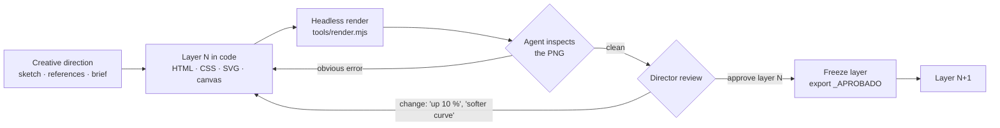

```
source/
  00_brief/BRIEF.md            brief + approval log (one line per approved layer)
  01_brand/                    tokens.css · logos · Geologica (OFL)
  02_source/                   the theme's real CSS · product photos · captured sections
  03_layers/cover.html         THE design: one <section class="layer lNN"> per layer
  03_layers/layers/LNN-*.css   one stylesheet per layer (plus L06-curvatura.js)
  03_layers/sections/          static replicas of the live theme (home, PDP) at a 390 px viewport
  tools/render.mjs             exporter (Chrome headless)
process/LNN/                   every iteration of every layer, in order
docs/handoff-to-codex.es.md    the handoff that let a second agent continue
final/                         the delivered cover
```

## 5. Layer by layer — the iterations

The director's notes below are translated from the original Spanish feedback.

### Layer 1 — Background

**Goal.** A brand gradient with depth, whose brightest point would later sit where the cursor pulls.

<table>
<tr>
<td><br><sub>A · sapphire → orange</sub></td>
<td>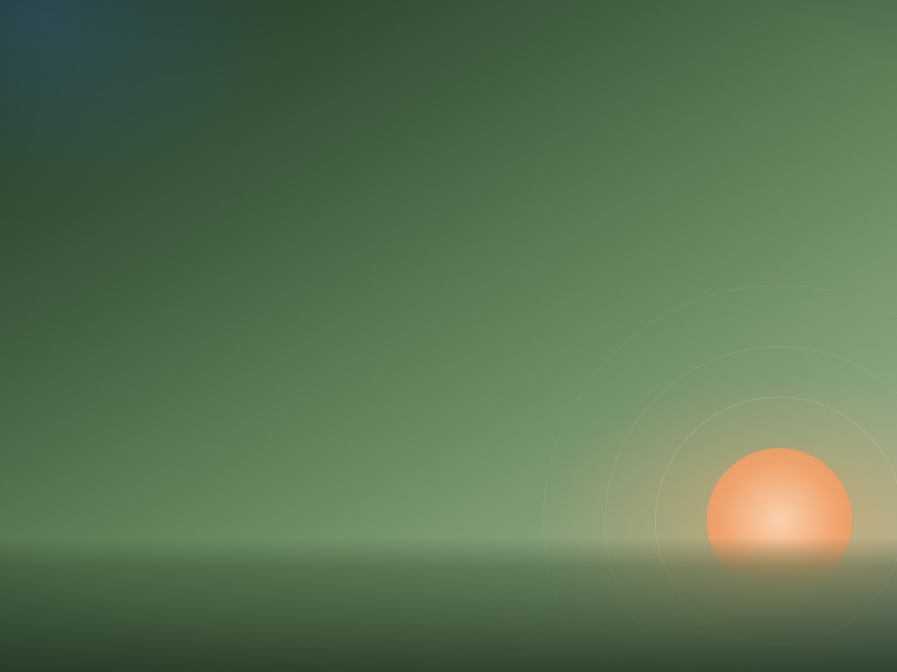<br><sub>B2 · literal sun</sub></td>
<td><br><sub>E · organic aurora</sub></td>
</tr>
<tr>
<td><br><sub>F · single light source</sub></td>
<td>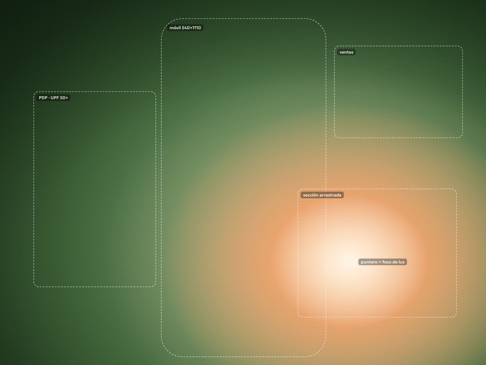<br><sub>F + composition guide</sub></td>
<td><br><sub><b>G2 · approved</b></sub></td>
</tr>
</table>

> *"Make it more creative — softer, more blended, more organic. Green and orange."*
> *"I liked it but it's too obvious; make it subtler and more organic, like this one."*
> *"It needs more darkness at the top — but organically."*

**Decision.** Organic blobs blurred at 130 px, a dark organic top, and a subtle peach focus driven by two variables (`--fx/--fy`). A composition guide (`?guide=1`) was drawn over the background *before* any element existed, so the light could be aimed at the future cursor.

### Layer 2 — Typography

**Goal.** The message, in a hierarchy that never collides with the objects to come.

<table><tr>
<td>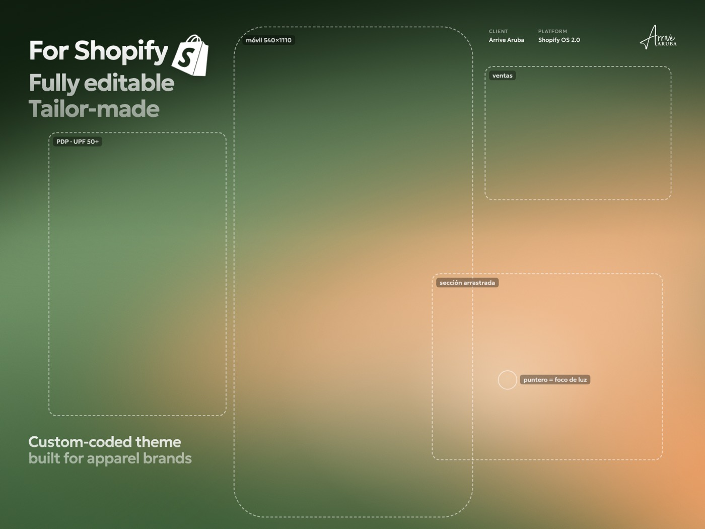<br><sub>Text checked against the layout guide</sub></td>
<td><br><sub><b>Approved</b></sub></td>
</tr></table>

> *"Use only Geologica. You can see from your own composition template that this text will be hidden by the phone."*
> *"Remove the periods. The visual priority has to be the word Shopify."*
> *"'For Shopify' got too much weight, and the others fade too much. Make the Shopify logo 30 % bigger."*

**Decision.** *For Shopify* plus a tilted Shopify bag, with *Fully editable* and *Tailor-made* fading line by line. The logo's box is fixed at the line height, so making the logo bigger never pushes the lines below it.

### Layer 3 — The phone with the real website

**Goal.** Show the client's actual store, not a picture of a store.

<table><tr>
<td>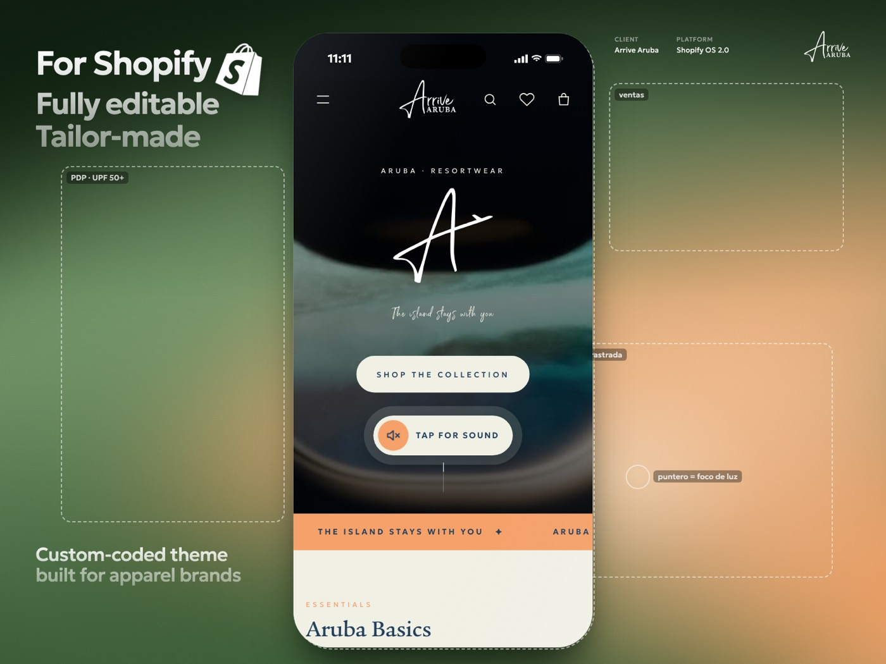<br><sub>Iteration with guide</sub></td>
<td><br><sub><b>Approved</b></sub></td>
</tr></table>

**Technique.** The home page (header, hero, ticker, featured collection) is a static replica that loads the **theme's real `critical.css` and `theme.css`**. It is mounted in a 390 px `<iframe>` (a true iPhone viewport) and scaled ×1.3846. The frame was dropped at the director's request; the camera island and an *11:11* status bar were kept. The web content starts below the status bar, the way Safari renders it.

> *"I want the phone without the frame."* · *"Show more of the hero and less of the next section — when we pull it out, it will show anyway."* · *"The header has to be visible, complete, under the camera."*

### Layer 4 — The section pulled out like paper

**Goal.** Make *"editable"* visible: a real Shopify section leaves the page as a curved sheet, carrying the theme editor's blue selection outline.

<table><tr>
<td>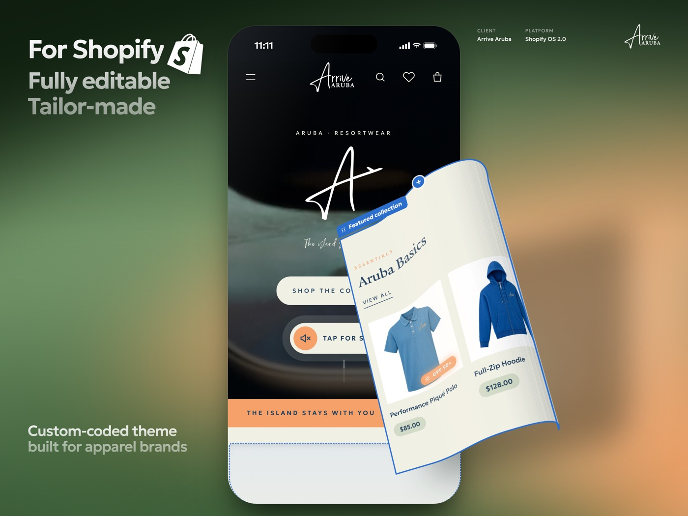<br><sub>Variant A · global perspective</sub></td>
<td>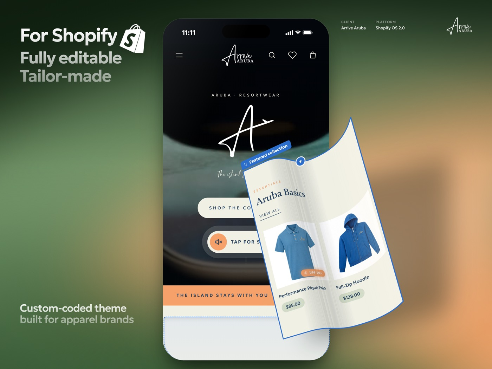<br><sub>Variant B · S-curve</sub></td>
<td>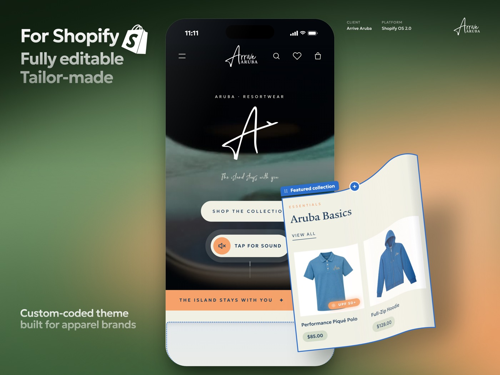<br><sub><b>Approved</b></sub></td>
</tr></table>

**What failed first.**
- CSS 3D strips left seams and an "accordion" look.
- A Bézier mesh was rejected as *"horrible"*.
- A folded corner was removed: *"take that fold off the end."*

**Technique that worked.** The real section, captured at 3×, is drawn on a canvas in **1 px vertical strips**, each with its own perspective scale. The result is a continuous curve with no seams. Five numbers control the whole shape: flat length, maximum turn, where the end turns down, lift, and crop.

> *"Two curves: first inward, then it ends outward."* · *"Keep this one, just add a small curve at the end that finishes downward."* · *"The top corner is being cut, and soften those curves."*

### Layer 5 — The cursor

**Goal.** The hand of the editor: an object that pulls.

<table><tr>
<td><br><sub>Vector hand</sub></td>
<td>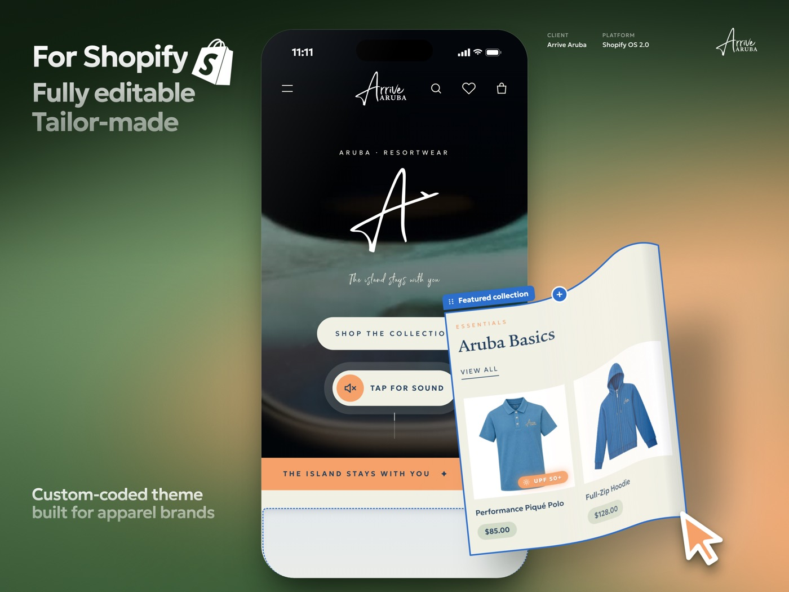<br><sub>Vector arrow</sub></td>
<td>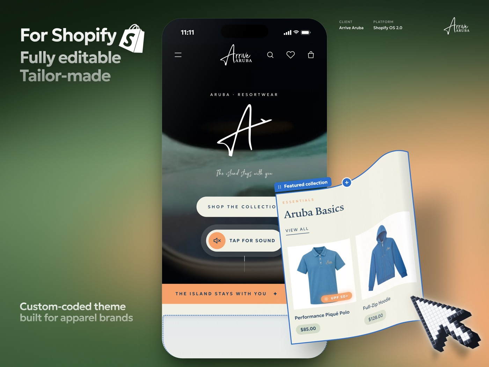<br><sub><b>Approved · voxel cursor</b></sub></td>
</tr></table>

> *"Better — a more 3D pointer, bigger, with perspective."* · *"Why orange? Let's go with one in this style"* (a reference of the classic pixel cursor in 3D voxels) · *"Add a small glow."*

**Technique.** The classic 12 × 20 pixel cursor is generated from a character grid in Python into SVG. Each pixel becomes a block: a raised charcoal border, a white fill with a visible pixel grid, and 14 offset layers that give it thickness. CSS 3D perspective, a cast shadow and a warm glow finish it.

### Layer 6 — Product card with UPF 50+ (continued in Codex)

<table><tr>
<td>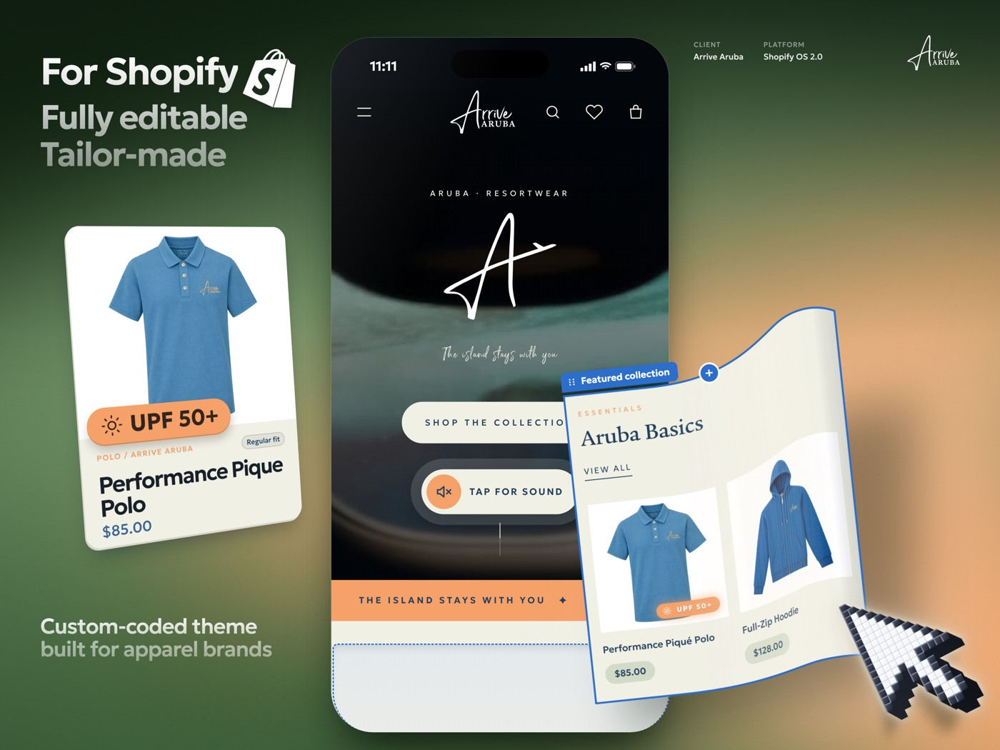<br><sub>v1</sub></td>
<td>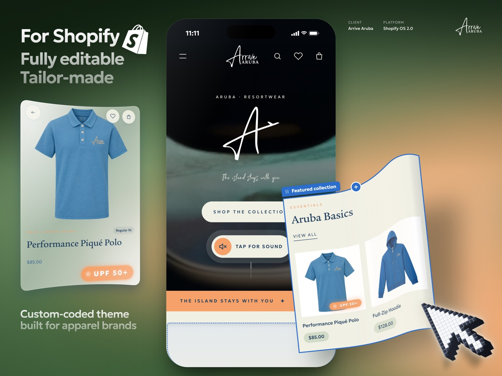<br><sub>Liquid glass</sub></td>
<td>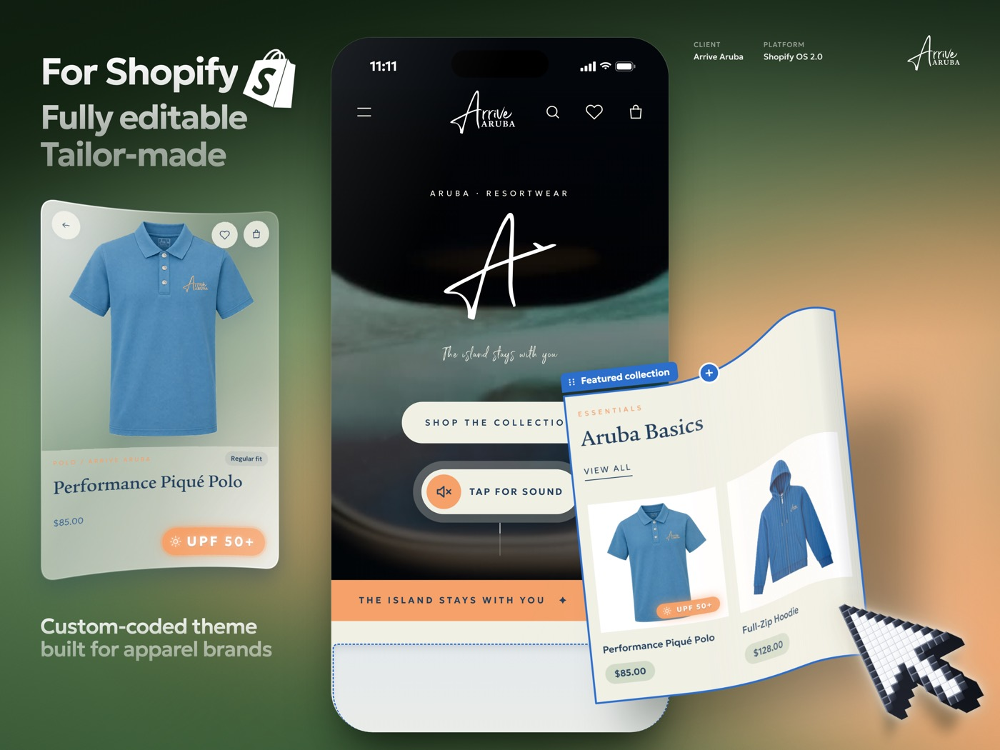<br><sub><b>Approved</b></sub></td>
</tr></table>

> *"Who told you to create it? Extract the real product page of the website from GitHub."*
> *"That UPF 50+ button isn't the original — put it in the corner opposite the price, with its glow like the original."*
> *"Everything — icons, text, buttons, the image — has to follow the curve and the perspective."*

**Technique.** The real PDP markup from `sections/product.liquid` sits on a "liquid glass" panel (`backdrop-filter`, an SVG `clip-path`). The content is bent with an **SVG `feDisplacementMap`** whose displacement map is generated on a canvas (`L06-curvatura.js`), so photo, text and buttons all follow the same curvature.

### Layer 7 — Sales card (continued in Codex)

<table><tr>
<td>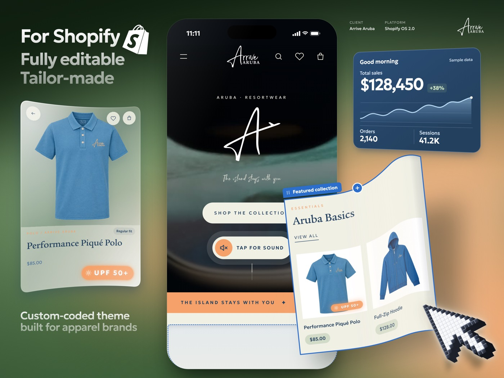<br><sub>v1</sub></td>
<td>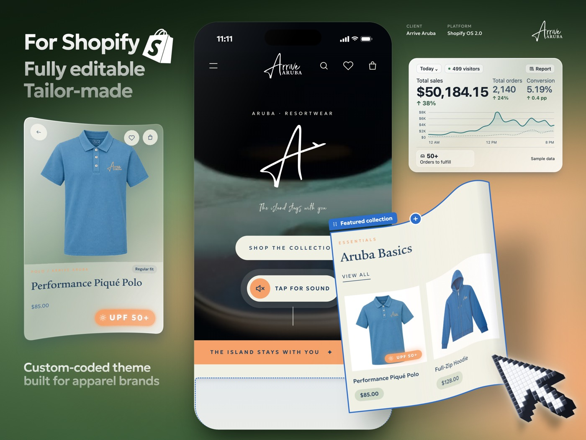<br><sub>v8</sub></td>
<td><br><sub><b>Approved · after 15 glass iterations</b></sub></td>
</tr></table>

> *"I want it literally identical in composition to Shopify's — copy it."* · *"The perspective has to point down, as if it came out of the Shop the collection button."* · *"Exaggerate the perspective 20 %, with the vanishing point at the center of the design, and make the curve 20 % less."*

**Technique.** The analytics card is rebuilt in HTML with the same glass and displacement curvature as the product card, so the two read as a family. Its figures are aspirational and labelled **"Sample data"** on the card itself.

### Layer 8 — Shopify logo

Resolved inside Layer 2: the official bag icon sits next to *For Shopify*.

### Layer 9 — Signature, margins and the Upwork crop (continued in Codex)

<table><tr>
<td><br><sub>Signature in white</sub></td>
<td>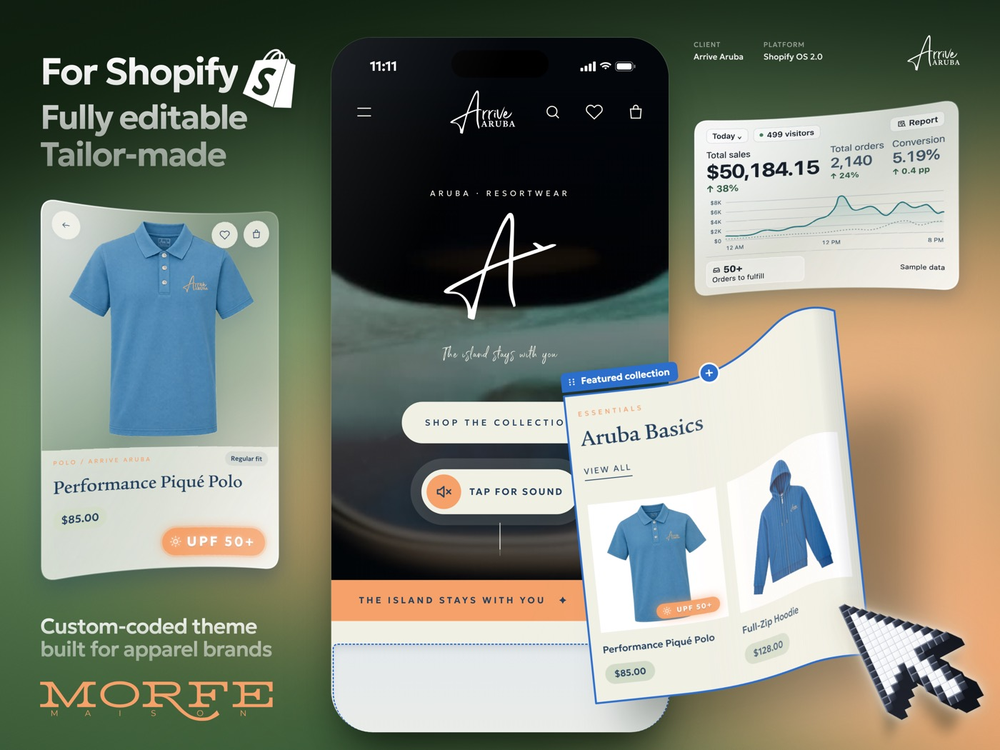<br><sub>Orange, resized and repositioned</sub></td>
<td><br><sub><b>Final metadata and margins</b></sub></td>
</tr></table>

> *"Make the logo end where the word 'theme' ends."* · *"Move everything on the sides 10 % inward — the margins, except the cursor."* · *"It has to weigh 5.2 MB at most."*

**Technique.**
- The Morfe Maison wordmark is an SVG used as a CSS `mask`, so it can be recolored to the brand orange.
- A `layout=upwork` mode (`upwork-crop.css`) rescales the side columns into Upwork's thumbnail crop without touching the approved composition.
- The final file was exported at 2560 × 1920, under the platform's size limit.

<div align="center">
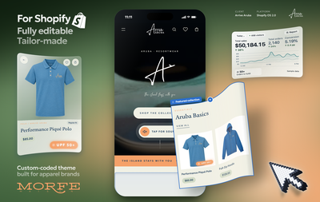<br>
<sub>How the cover reads at Upwork's thumbnail size.</sub>
</div>

## 6. Two agents, one process: the Codex handoff

The process was designed to be **tool-independent**. Layers 1–5 were built in one coding-agent session. Before switching tools, the agent wrote a handoff document ([`docs/handoff-to-codex.es.md`](docs/handoff-to-codex.es.md), in Spanish, the working language). It contains:

- The non-negotiable rules: code only, no generated images, one approval per layer, only Geologica, no periods.
- The canvas, grid and folder structure, and the exact render command.
- The status of each layer, with the **parameters of everything approved**, so it would never be broken (`scroll=85&hero=660`, `TMAX=64°`, `SY0=135`…).
- What had been **rejected**, so it wouldn't come back: the folded corner, the Bézier mesh, the orange cursor, backgrounds A–F.
- Technical traps already solved: headless Chrome's minimum width, layer `isolation`, relative paths, canvas clipping.
- How the director likes to work.

**OpenAI Codex** then continued from that document alone. It built Layers 6, 7 and 9, the Upwork layout and the final export. It kept the same loop (code → render → inspect → director review → approve), and nothing approved was lost. The second phase added about 42 more iterations under the same rules.

This is the core of the thesis: **when design lives in code, layers and written decisions, the process belongs to the designer, not to a tool.** Any capable agent can pick it up where the last one stopped.

## 7. How each AI-image problem was solved

| Problem | Solution in this process |
|---|---|
| No fidelity to the real product | The phone renders the **client's real theme CSS** in a real 390 px viewport. The product photos are the catalogue files. |
| Broken text | Text is live HTML text: the real product names, prices and copy. |
| Off-brand color and type | Colors come from the theme's settings file. Fonts are the brand's own `woff2` files. |
| No surgical edits | Each layer is isolated. *"Up 10 %"* is one number. 84 iterations, and none of them redrew the other layers. |
| Non-determinism | Rendering is deterministic. Approved layers are frozen and re-render identically. |
| No source / no handoff | The whole design is a repository. A written handoff let a second agent continue without loss. |
| Unclear provenance | Every pixel traces back to a file in `source/`. |

**By the numbers.** 9 layers · 84 documented iterations · 2 coding agents · 1 creative director · 0 generated images.

## 8. Reproduce it

Requirements: macOS with Google Chrome, and Node.js 18 or later.

```bash
git clone https://github.com/morfemartin/layered-design-in-code
cd layered-design-in-code

# render up to layer N on the approved background (G) → source/04_exports/
node source/tools/render.mjs 5 G layer5.png            # 3200 × 2400 (2×)
GUIDE=1 node source/tools/render.mjs 5 G guide.png 1   # with the composition guide
Q=layout=upwork node source/tools/render.mjs 9 G final.png 1.6   # final Upwork cover, 2560 × 1920
```

> **Fonts.** The brand's commercial typefaces (Arrive Legacy and Port Blair) are licensed and **not included**. The cover itself uses only Geologica (SIL Open Font License, included). Without the commercial files, the text inside the phone falls back to a system serif; everything else renders the same.

## 9. Credits and licensing

- **Creative direction and design:** Martin Morfe — Morfe Maison.
- **Client:** Arrive Aruba, premium resortwear from Aruba. Brand assets, product photography and the Shopify theme are shown as a portfolio case study.
- **Execution:** AI coding agents under creative direction. Phase 1 used a coding agent in a terminal session; phase 2 used OpenAI Codex.
- **Code** (HTML, CSS, JS, render tooling): MIT. See [`LICENSE`](LICENSE).
- **Brand assets** (logos, photography, brand fonts): © their respective owners. They are not licensed for reuse.
- **Geologica:** SIL Open Font License 1.1 ([`source/01_brand/fonts/Geologica-OFL.txt`](source/01_brand/fonts/Geologica-OFL.txt)).
- Shopify and the Shopify bag logo are trademarks of Shopify Inc., used here to identify the platform.

<div align="center"><br><sub>Design is a process, not a prompt.</sub></div>
